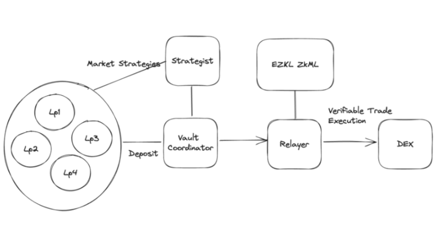

這系列將會介紹不同 zk 在區塊鏈上的應用，除了幾種有名的 zk 應用之外也會介紹在各地 hackthon 所得獎的作品，將會從作品的介紹,程式碼以及該產品可能產生的問題去進行分析
## Introduce
[ZkAlpha](https://ethglobal.com/showcase/zkalpha-twwtg) 是一支在 ETHGOBAL PARIS 獲得多項獎項的團隊，主要開發人員為在 zkml 打造 l2 產品的開法者。他們打造了一個交易平台，結合量化交易員以及流動性供應商(LP)，允許量化交易員在不洩露交易策略的情況下進行交易。

這個平台允許交易員創建一個專屬的金庫，與特定的交易模型相對應。通過這個金庫，他們可以收集資金，包括來自流動性提供商和其他用戶的資金。然後，交易員可以透過這個平台使用這些收集來的資金進行匿名交易，而平台會使用 ZKML 技術來驗證交易的準確性。這個創新性的解決方案為量化交易領域帶來了更高的安全性和隱私性。

## Architecture

接下來會介紹整體的架構，整個架構皆會由智能合約組成運行。首先可以看到分別會有 strategist 也就是交易員負責提供交易模型以及藉由交易模型進行交易，另外還有左邊的 LP 也就是流動性提供池負責提供資金並且選擇交易模型進行投資。整個平台將會有 smart contract 來進行互動，其中 relayer 用來審核交易員進行動作的合法及正確性，並且幫助交易員進行交易。
以下則會是整個平台運作的流程：交易員可以透過註冊新的交易模型去向 relayer 申請一個新的金庫(vault)，而 LP 也就是所有的資金能則可以向這個金庫投入對應想要投資的金額，交易員則可透過將資金 deposite 到 relayer 並且執行符合交易員提交的交易模型的交易策略， relayer 會透過交易員所提交的 proof 以及想操作的交易去進行 zkp 的驗證，驗證成功即進行交易，交易後交易員可將資金從 relayer 提出並且使這些資金能被資金提供者(LPs, users)去進行提出的動作，接下來會針對每個 component 進行介紹並且列出其中所使用的程式碼 


## component
### vault
每個金庫皆會對應到一個交易模型，建立金庫的同時會上傳哈希過後的交易模型給 relayer 。
金庫會分成三個狀態: Deposit, waiting, withdraw ，Users 或 LPs 會透過這三種狀態分別與金庫產生不同的交互行為。首先是 deposit ，在該階段用戶可以將資金存入金庫內來參與投資。當資金被 trader 放入 relayer 進行交易時會進入 waiting 的階段此時資金不能存入以及提出，當交易結束後資金從 relayer 返還後會進入 withdraw 的階段，此時用戶即可在這個階段將資金提出。

### relayer
Relayer 用來當作中繼器，負責進行驗證並且完成 trader 所要執行的交易，其中會進行驗證的為 trader 是否有權力動用資產, trader 的交易是否符合該金庫對應到模型所產生的結果。
首先在第一種情況也就是 trader 是否能動用資產， relayer 會透過 merkle tree 來對存入的資產進行處理，其中每個 node 即會對應到每次存入的某一筆資產的 commitment，而 commitment 所含的資料則是 secret, nullifier, balance, cmodel, address ， nullifier 用來記錄該筆資產的狀態是否交易過， secret 為該筆資產使用者所知道的私鑰。 relayer 會透過打開這個節點確定來進行資產的驗證，以下列程式碼為例，當交易員要進行交易時同樣需要先對資產進行驗證，可以在 transactCircuit 內看到有 `verify_merkle_proof()` 來對傳入的資產資料驗證是否在 merkel tree 內，當確定有該筆資源才能接著進行後續的動作。
第二種情況也就是要在交易前先去對交易進行驗證是否有符合模型所產生的結果，為了確保交易員不會送出不屬於一開始所提出的交易策略因此利用 zkml 的方式來進行驗證，這個驗證方式會將交易前後的金額傳入 model 內確定結果與交易策略產生的結果相同再進行交易。我們對應到以下程式在第38行的地方會透過執行 model 來驗證是否結果有相符，這部分的程式碼並非是完成品且有些問題我們會在後面進行討論。
```python=
class MerkleProofCircuit(nn.Module):
    """
    gadget for proving merkle tree inclusion
    path[-1] is root, public
    """
    def __init__(self):
        super(MerkleProofCircuit, self).__init__()
        self.hasher = Hasher()

    def verify_merkle_proof(self, leaf: Field, index: Field, path: List[Field]):
        current_hash = leaf
        for sibling in path[:-1]:
            if index % 2 == 0:
                current_hash = self.hasher.hash2(current_hash, sibling)
            else:
                current_hash = self.hasher.hash2(sibling, current_hash)
            index = index // 2
        return current_hash - path[-1]

    def forward(self, x):
        leaf, index, *path = x # assume len(path) == height of the tree
        return self.verify_merkle_proof(leaf, index, path)
class TransactCircuit(nn.Module):
    def __init__(self):
        super(FinalizeCircuit, self).__init__()
        self.hasher = Hasher()
        self.model = TradingModel()
        self.merkle = MerkleProofCircuit()
        self.openNode = OpenNodeCircuit()

    def forward(self, x):
        k, s, b1, b2, cModel, addr, cNode, index, nullifier, b12, b22, *y = x
        model_input = y[:n_model_input]
        path = y[n_model_input]
        y0 = self.merkle.verify_merkle_proof(cNode, index, path)
        y1 = self.openNode([k, s, b1, b2, cModel, addr, cNode])
        y2 = self.hasher.hash(k) - nullifier
        model_output1, model_output2 = self.model(model_input)
        y3 = b1-b12 - model_output1
        y4 = b2-b22 - model_output2
        # assume the output 0
        # public: delta1, delta2, nullifier (delta from nullifier)
        return [y0, y1, y2, y3, y4]
```

### commitment model
commitment model 是對應到金庫的交易模型的 commitment ，其產生的方式則是將一個由 pytorch 所產生的交易模型在訓練後將其 hash 產生，也就是 `Cmodel = H(model)`，這是在 EZKL 內對於模型驗證的一種方式，當模型進行驗證時，除了驗證輸入輸出是否符合模型結果亦會驗證傳入的 model hash 後是否跟 Cmodel 一樣，這裡的驗證都是透過 zkp 來解決，因此驗證者不會真的知道 model 到底是什麼。


## Discuss
### Issue
1. 作者有提到他們的 pytorch modules 也就是 circuits 沒辦法輸出成 .onnx 的檔案，這個部分猜測可能為 .onnx 本身沒辦法支援他們所寫的程式碼，他們在 relayer 的各種判斷接寫成 model 的方式導致沒辦法直接產出，可以解決的方法可能為直接將其寫成最抵成的 hola2 。
2. 在 relayer 的各個 interface 皆需產生 proof 來進行可能會導致交易速度過慢以及使用者體驗過差的問題，除了 model 的執行結果是否正確以外，其他交互的過程雖然需要透過 merkle tree 來進行驗證節點是否相符但只需直接在鏈上進行驗證而不需要透過 zkp 的方式。
 

### Risk
1. 第二點我們在討論 relayer 的交易的 circuit 裡面有提到，在這份專案裡是直接執行訓練完的 model 來驗證輸入輸出是否正確會產生幾個問題，model 在這種情況下需要將 model 存在 relayer 或是每次都當作與 relayer 的合約交互的輸入，這兩種方式都已經將交易模型洩漏給 relayer 所知道並不符合不洩漏交易資訊的原則，因此比較正確的方式應該是 model 的驗證上才是需要利用 zkp 驗證是否有符合正確的結果，交易員產生符合輸入輸出結果的 proof 並且利用 EZKL 的方式來對結果進行驗證。
2. 當每次要執行交易時要先從金庫將錢存入 relayer 並且執行交易，這過程不僅複雜並且有可能透過 vault 的資金變化來推測出交易策略。
3. trader 在丟入的輸入例如價格前後的變化是可以透過假造的資料來騙取 proof 通過，例如今天假造一個新的價格變化但並非實際的價格可以使用該價格進行原本不該出現的操作並且能通過驗證，由於價格的變化依舊是從 model 內產生並且由於 Relayer 本身不會去查詢現在的價格是多少因此該方式是符合 model 變化而會變驗證通過


