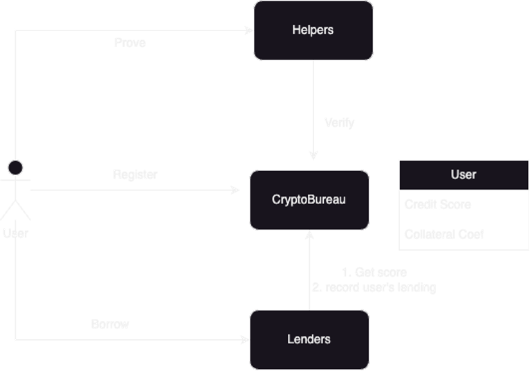

這系列將會介紹不同 zk 在區塊鏈上的應用，除了幾種有名的 zk 應用之外也會介紹在各地 hackthon 所得獎的作品，將會從作品的介紹,程式碼以及該產品可能產生的問題去進行分析
## Introduce
在目前 web3 的借貸平台中，大部分借貸的方式為超額抵押，超額抵押就是抵押品的價值要超過借出的金額，在 web3 中當抵押品的價值低於某個與借出金額相關的比例後就會將抵押品拍賣掉以避免借貸平台的損失。 [CryptoBureau](https://ethglobal.com/showcase/cryptobureau-u1389) 就是想解決該方式所產生的問題，該方式所造成的低信任度以及比較低的安全問題，還有在這方式下借貸方式比較沒有彈性，第三個則是必須用更高的抵押物去做借貸。 [CryptoBureau](https://ethglobal.com/showcase/cryptobureau-u1389) 是提供一個平台透過零知識證明的方式去證明該借貸人員的信任程度，提供借貸人的信用分數來作為借貸指數的基準，減少對於抵押品的過度需求增加借貸的信任關係。

## Architecture

整個平台將會由 CryptoBureau 這個合約所組成，使用者會透過在該平台進行註冊來獲得使用者資訊，並且與 Lenders 以及 Helpers 進行互動。 Lenders 以及 Helpers 將會由 CryptoBureau 的 owner 所指定與該平台進行互動的合約。 Lenders 即為借貸項目，可以從 CryptoBureau 取得使用者的信用分數去作為借貸抵押比例的計算基準， Lenders 也可將與用戶交互的資訊傳入到 CryptoBureau 的合約內進行記錄來影響信用分數的變動。 Helpers 則是負責驗證使用者的信任證明的合約，當 helpers 驗證完該使用者有該信任證明即可向平台進行驗證，平台接收到後會寄而影響到該使用者的信用分數，在此次項目中用到的證明有 worldcoin 的真人證明, 透過 polygonID 的學位證明以及 Sismo 的錢包財富證明，這幾種證明方式將會在後續的文章中詳細介紹。

## Component
### CryptoBureau
借貸協議平台合約，用來提供每個用戶的信用分數使得 lenders 可以利用該分數來計算借出的金額。 Owner 在該平台可以設置 Lenders 和 Helpers 與該合約互動。用戶可以透過註冊的方式來留下自己的信用分數，而註冊的方式將會是由 worldcoin 的方式來確認是否為唯一真人來避免使用者申請多個帳號，當通過 worldcoin 驗證後才能完成註冊。在該平台上除了紀錄每個用戶的信用分數外也會紀錄用戶存入的流動性資產以及借款還款的狀況以此當做信用分數的其中一項標準。
#### Credit score
信用分數主要會由兩種方式去計算出來
1. Helpers 透過 zkp 的方式去驗證使用者是否達到某個信用評比，可以避免使用者洩漏個人資訊。平台上也會在設定 Helpers 的同時去設定其變動乘數來當作信用分數變動的標準。
2. 借貸的交互，當借款人有更多借款以及更多還款時可以逐漸增加信用分數，如果借款大於還款時會導致信用分數降低。
基礎的信用分數會有一個上限，避免當用戶在不斷增加的借貸的交互中去增加無上限的信用情形發生。
### Helpers
Helper 如同上面所提到的是用來驗證用戶的某項信用證明，不同的證明項目會有不同的合約來與平台做互動，當 Helper 證明完用戶資訊後即可透過下列的程式碼在平台上幫用戶進行驗證，呼叫 CryptoBureau 內的 `verify()` 來證明，當被呼叫後 CryptoBureau 上會紀錄該項已被證明以及去調整該用戶的基礎信用分數。
```solidity=
// Helper functions on CryptoBureau
function verify(address account) external override onlyHelper {
    HelperConfig storage config = _helpers[msg.sender];
    ScoreData storage data = _scoreDataForAccount(account);

    require(!_usedHelpers[_accounts[account]][msg.sender], "CryptoBureau: Already verified");

    _usedHelpers[_accounts[account]][msg.sender] = true;

    data.base = data.base * config.multiplier / 1 ether;

    if (data.base > _maxBaseScore) {
        _maxBaseScore = data.base;
    }
}
```

### Lenders
Lenders 如同上述所說為一個借貸合約，可以透過拿取平台上的用戶信用分數來作為計算抵押借貸的比率，如下面程式碼所呈現，當用戶在該借貸合約借取 tokens 時會先去平台上拿到用戶分數，可以在 `collateralRequired()` 內看到拿到分數後去計算需要多少的抵押數量，如果抵押數量不足時無法借貸。
```solidity=
function collateralRequired(address account, uint256 amount) public view returns (uint256) {
    Bureau.Score memory score = _bureau.score(account);

    uint256 _lendingValue = _tokenValue(LENDING_TOKEN, amount);

    return _lendingValue * score.collateralCoef / 1 ether;
}

function borrow(uint256 amount) external {
    address account = _msgSender();

    uint256 _current = _collaterals[account];
    uint256 _required = collateralRequired(account, amount + _loans[account]);

    require(_current >= _required, "ERC20Lender: Not enough collateral");

    _loans[account] += amount;

    LENDING_TOKEN.transfer(account, amount);

    _bureau.onBorrow(account, _tokenValue(COLLATERAL_TOKEN, amount));
}
```
另外在每次借貸時都會去紀錄借款及還款的紀錄，如上面程式碼所示會呼叫平台上 `onBorrow()` 來紀錄借款的紀錄，在還款的時候也會紀錄在平台上已作為用戶分數的計算，下面程式碼即是 CryptoBureau 上紀錄的程式碼，可以看到使用者內會有 totalBorrowed 和 totalRepaid 來紀錄借貸紀錄。
```solidity=
function onBorrow(address account, uint256 value) external override onlyLender {
    ScoreData storage data = _scoreDataForAccount(account);
    data.totalBorrowed += value;
}

function onRepay(address account, uint256 value) external override onlyLender {
    ScoreData storage data = _scoreDataForAccount(account);
    data.totalRepaid += value;
}

function onIncreaseCollateral(address account, uint256 value) external override onlyLender {
    ScoreData storage data = _scoreDataForAccount(account);
    data.totalCollateral += value;
}

function onDecreaseCollateral(address account, uint256 value) external override onlyLender {
    ScoreData storage data = _scoreDataForAccount(account);
    data.totalCollateral -= value;
}
```
## Discuss
### Issue
1. 超額貸款的方式在 web3 的可行性
目前在銀行體系中對於借貸未還款有比較強硬的執行方式，例如法院的強制執行可以直接去凍結某個用戶的資產已達到收回款項的可能性，這使得 web2 銀行體系中出現了多種的超額借貸的方式，例如信貸直接透過信用來借取低利貸款，但在 web3 的世界中目前尚未有一個可以強制執行的方式因此才會在目前的借貸項目中皆會以超額抵押來取代其他方式，透過超額抵押來避免風險的存在，而在這個平台上依舊會存在該問題無法去解決被惡意借款並且不還款的風險。未來可能可以透過智能合約錢包來解決類似的問題，例如將智能合約的錢包內加入強制執行還款的功能，讓該錢包註冊在該平台上時即可有可能產生強制執行的方式，但會衍生出其他問題例如誰來判定是否能強制執行，第三方的判定又會導致中心化的問題，另外也有可能產生無法判斷哪些錢包是否有該功能，如果用 proxy 的方式有可能直接隱藏某個介面的實作方式導致無法判斷當錢包有該介面時是否為真的強制執行的實作。
2. 隱私問題
在 web3 內還是會希望用戶的帳戶也就是錢包本身不會與用戶本身有所連結，但是再過多的信用驗證的同時是不是有可能導致用戶本身的資訊在交互驗證下資訊洩漏，雖然透過 zkp 可以減少洩漏的發生可能，但如果有人利用較複雜的驗證方式來逐漸篩選還是有可能導致資訊洩漏。
3. 中心化問題
Owner 在平台上擁有過多的權限，可以決定哪些 lenders 的加入以及各個 Helper 的信用分數的乘數，這兩個都會導致整個平台的漏洞，例如可以隨意加入有問題的 lenders 破壞用戶的借貸紀錄， Helpers 的乘數在不同借貸平台可能會有不同的證明需求在不同的證明下希望有不同的乘數，過度中心化的乘數可能會減少借貸平台加入的可能性。
### Risk
1. 使用者偽照資訊 
使用者向驗證者提供的資訊是偽照的資訊，使用者可以利用別人的第三方證明來驗證自己的帳戶藉此來提高個人的信用分數，例如使用別人的 sismo wallet 來驗證自己的財富狀態，在這個情況下該使用者的驗證資訊會出現極大的偏誤狀態，這需要透過修正每個 Helper 的驗證方式來確保該狀況不會發生。
2. lenders 惡意提供錯誤資訊 
lenders 有可能向平台提交錯誤的使用者交易資訊，例如額外增加某外使用者的交易紀錄數據來幫助使用者增加其信用紀錄，這個問題可能可以透過 oracle 的方式來獲取 lenders 本身在交易時所產生的資訊來進行驗證，避免該情況的出現。